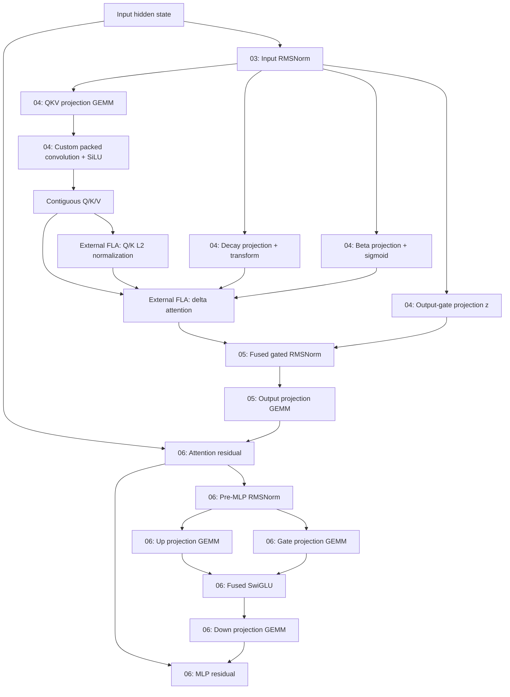

# Integrated compiled structure and subsequent fusion targets

Follow-up to [batch-one measurements and FLA layout investigation](batch-one-fla-layouts.md). This records the discussion after the packed-output integration, including the fresh source dump and proposed next experiments. The combined gate-transform kernel is now a source-reviewed prototype; it has not been GPU-tested, benchmarked or integrated.

## Current result and immediate next steps

The integrated packed-output convolution improved the initial ten-measurement batch-one median graph-backed forward from 148.59 ms to 140.72 ms, about 5.3%. The tested decision probabilities were unchanged. This remains one request and forward-only timing, excluding tokenization/readout.

The next validation steps are broader requests at batch sizes one, two and four, probability comparisons, and end-to-end latency measurements. A fresh runtime trace should confirm removal of the three copies per delta layer and check unexpected allocations or graph breaks. A source dump helps inspect structure but does not replace runtime evidence.

Convolution with integrated Q/K normalization remains a candidate. Compare it against the packed-output producer plus existing FLA normalization, preserving intermediate BF16 rounding and keeping only measured improvements. Full-attention backend selection is another investigation, accounting for approximately 8.5% of the earlier batch-one listed GPU activity.

## Why optimize a delta block rather than rewrite the whole forward

Manual control is most valuable at producer/consumer boundaries: jointly choose layouts, remove intermediate allocations and traffic, and fuse operations where the complete sequence improves. Replacing already-fused pointwise kernels one-for-one is not automatically useful.

A delta-attention block is a contained experimental unit repeated eighteen times. It retains library GEMMs and FLA computation while exposing projection preparation, normalization/gating and residual boundaries to inspection. The convolution change established one measured benefit in that scope. Benchmark each complete block change before consolidating a manual block executor or expanding to a handwritten model runtime.

The earlier batch-one profile attributed approximately 68% of listed GPU activity to GEMMs and another 8.5% to full attention. Keeping those unchanged leaves less than a quarter for everything else, including retained FLA computation. This is a rough bound from old kernel-time shares, not a fresh critical-path analysis or a prediction of end-to-end gains.

No single GPU kernel covers the delta block. `Qwen3_5GatedDeltaNet.forward` orchestrates its attention operations; the supported path now uses `_forward` in `model/decider/packed_conv.py`. Input RMSNorm and residual addition belong to the enclosing decoder layer. The MLP is a separate sublayer after attention.

## Fresh post-integration source dump

Ran on Modal:

```bash
modal run src/dump_compiled_code.py --rows 1 --batch-size 1
```

Run: https://modal.com/apps/vijaygoyal0770/main/ap-i8MIRvgKD5WfxN8zJv3V6z

Generated eight complete Python files and downloaded them individually to `data/l4-source-b1-packed/`. All eight passed Python syntax compilation. Configuration was decider-2b-v11 on NVIDIA L4, token IDs `[1, 2048]`, PyTorch `2.14.1+cu130`.

| Source file | Characters |
| --- | ---: |
| `compiled_forward_01.py` | 23652 |
| `compiled_forward_02.py` | 30258 |
| `compiled_forward_03.py` | 10624 |
| `compiled_forward_04.py` | 16654 |
| `compiled_forward_05.py` | 12938 |
| `compiled_forward_06.py` | 23097 |
| `compiled_forward_07.py` | 118637 |
| `compiled_forward_08.py` | 7221 |

The custom Triton body remains in `model/decider/packed_conv_kernel.py`. Its opaque custom operation appears in the generated wrapper as `torch.ops.fastdecisions.packed_conv.default`; Inductor does not inline that implementation into the dump.

### Partition map

These files represent reusable compiled fragments, not eight sequential decoder layers or a count of runtime invocations.

| File | Role | Relevant code |
| --- | --- | --- |
| 01 | Causal/sequence mask preparation | [launches](../data/l4-source-b1-packed/compiled_forward_01.py#L292) |
| 02 | Rotary position preparation | [launches](../data/l4-source-b1-packed/compiled_forward_02.py#L347) |
| 03 | Input RMSNorm | [launch](../data/l4-source-b1-packed/compiled_forward_03.py#L156) |
| 04 | Delta QKV projection, packed convolution, decay/beta preparation and output-gate projection | [wrapper](../data/l4-source-b1-packed/compiled_forward_04.py#L171) |
| 05 | Fused delta output RMSNorm/gating and output projection | [wrapper](../data/l4-source-b1-packed/compiled_forward_05.py#L164) |
| 06 | Residual plus pre-MLP RMSNorm, MLP projections/SwiGLU and final residual | [wrapper](../data/l4-source-b1-packed/compiled_forward_06.py#L267) |
| 07 | Full softmax-attention layer path and its MLP | [wrapper](../data/l4-source-b1-packed/compiled_forward_07.py#L1238) |
| 08 | Restricted option-letter projection for all positions and FP32 conversion | [wrapper](../data/l4-source-b1-packed/compiled_forward_08.py#L101) |

Relative links point to local generated artifacts, which are ignored by Git. Line fragments document inspected locations; editor support for them may vary.

### Current delta flow

Arrows represent data dependencies, not concurrent execution. Skip connections are shown explicitly.



The attention residual and following RMSNorm are fused in partition 06. The final residual kernel can read the original hidden state and attention output to reconstruct the residual while adding the MLP output, rather than requiring every conceptual diagram node to correspond to a standalone materialized buffer.

External FLA still performs normalization, cumulative decay preparation, solve/w-u preparation, recurrent chunk-state computation (`h`) and output computation (`o`). Its internal kernels are not emitted by this Inductor source capture.

### What the custom-op boundary means

Partition 04 contains the QKV GEMM, custom packed-convolution call, and gate preparation in one compiled wrapper. The custom operation did not introduce a compilation break at that location. This does not fuse those operations into a single GPU launch: library GEMMs, the custom kernel and generated transforms still execute separately.

At lines 179-186, the wrapper checks Q/K/V output shape `[1, 2048, 16, 128]`, BF16 dtype and strides `[4194304, 2048, 128, 1]`. These match the fake implementation's promised contiguous layout. Runtime profiling is still the direct check that the former FLA contiguity copies disappear.

The fresh dump also confirms that output normalization and gating are already fused, and attention residual plus following RMSNorm are already fused. These are not obvious targets for separate one-for-one rewrites.

## Subsequent custom-kernel candidates

### Convolution plus Q/K normalization

The existing candidate removes copies but still materializes Q/K before FLA normalizes them. A fused producer could remove those intermediate writes/reads and normalization launches. It must cover all 128 features per head, reproduce BF16 rounding after SiLU before FP32 normalization, and disable FLA's duplicate normalization. V remains unnormalized. Reductions and register pressure can offset the saving; no gain is established yet.

### Narrow gate projections and transforms

Location: partition 04, in the branches feeding FLA alongside Q/K/V.

- Decay projection `a`: library GEMM at line 191.
- Decay transform: generated Triton at line 197, computing negative exponential of the learned decay parameter times softplus of the projected value plus bias.
- Beta projection `b`: library GEMM at line 203.
- Beta sigmoid: generated Triton at line 208.

Both projections read the same normalized hidden state and each produces 16 values per token. Combining them could reduce launches and repeated reads, but the total measured cost must justify it. Tiny activation durations alone do not establish useful savings.

The simplest experiment requires no custom matmul: concatenate the two projection weight matrices once, use a single library GEMM producing 32 values per token, then use one Triton kernel to produce decay and beta outputs. Preserve the projection BF16 rounding and output dtypes. This reduces the nominal sequence from two GEMMs plus two transforms to one GEMM plus one transform; it still materializes projection results.

A fully fused Triton kernel would implement both narrow matrix multiplications and their transforms before final stores. That is a separate, harder experiment.

### MLP projections plus SwiGLU

Location: partition 06, after attention residual and pre-MLP RMSNorm, before the down projection.

- Two library GEMMs at lines 272 and 277 produce gate/up activations.
- Generated Triton at line 283 applies SiLU and multiplication.
- Library GEMM at line 288 projects the intermediate down.

SwiGLU totaled approximately 6 ms in the earlier batch-one trace. A fused implementation might avoid storing both large projection intermediates, but requires efficient matmul as well as pointwise fusion. Preserve existing BF16 rounding boundaries when establishing correctness; removing them changes the computation.

An applicable library epilogue may offer another route, but ordinary activation support does not establish support for this exact two-projection SwiGLU operation. No compatible epilogue has been identified or validated in this work.

### Residual and normalization boundaries

Inspect remaining cross-layer boundaries for a materialized residual immediately reread by normalization. Several are already fused, so this is an investigation rather than an established opportunity. Choose layouts and buffer lifetimes across the complete sequence, not by optimizing isolated operations independently.

## What fusion with a library GEMM can and cannot mean

A normal Triton kernel cannot invoke a host-dispatched cuBLAS/CUTLASS library GEMM and then continue on its results within that same GPU kernel. Launching a library GEMM followed by Triton remains two launches with an intermediate tensor.

Eliminating that boundary requires implementing the multiplication within the fused kernel, or using a library implementation with the required epilogue. Existing Triton matmul templates can provide the multiplication structure; it is not necessary to design a matmul algorithm from scratch. However, adapting the projection pairing, precision behavior and tiling for L4 remains real engineering work.

There is no universal Triton matmul slowdown. A tuned implementation can compete for a specific shape; a basic implementation can lose substantially. The relevant criterion is

$$
T_{\mathrm{fused\ Triton}} < T_{\mathrm{library\ GEMM}} + T_{\mathrm{separate\ transforms}}.
$$

A fused matmul can tolerate some multiplication overhead only if eliminated traffic and launches compensate. Narrow 16-output gate projections are a more contained experiment than the large MLP projections, where a small GEMM slowdown could erase activation-fusion savings.

## Working order

1. Strengthen integrated correctness and latency comparisons over representative requests and low concurrency.
2. Audit a fresh runtime trace alongside the source dump.
3. Benchmark convolution with Q/K normalization fused against the current implementation.
4. Try concatenated gate weights with one library GEMM and one transform kernel, before taking responsibility for custom matmul performance.
5. Pursue MLP matmul/activation fusion only with evidence that the complete sequence improves.

The gate-transform component is now written, while its weight preparation and model integration remain planned. Other fusion ideas remain proposals. The only integrated speedup established so far is the packed-output convolution result documented in the preceding note.

## Combined gate-transform prototype

Implementation: [unpack_gate_transform_kernel.py](../model/decider/unpack_gate_transform_kernel.py). This prototype is written and has been source-reviewed; GPU compilation, numerical tests, benchmarking and model integration have not yet been established. The earlier candidate discussion describes the plan that led to this code, not a measured second speedup.

### Motivation

Each delta layer separately projects the same hidden state into sixteen decay values and sixteen beta values per token. Two generated Triton kernels then perform the respective transforms. The experiment is to combine the projection weights once, retain an existing library GEMM, and transform its combined result in one custom kernel.

This targets launch count and potentially repeated hidden-state reads without implementing a matrix multiplication ourselves. The proposed sequence changes two GEMMs plus two transforms into one wider GEMM plus one transform. The wider GEMM may select a different implementation, so fewer calls do not guarantee a gain. The very small existing transform durations are another reason to benchmark the complete projection/transform sequence.

### Weight preparation happens outside Triton

After model weights are loaded and any weight modifications are complete, PyTorch concatenates each layer's decay-projection and beta-projection weight matrices along their output-row dimension. The result is a 32-row matrix with decay first and beta second. This is a one-time preparation step before compilation or CUDA graph capture, not a concatenation per request and not retraining.

The plan is to keep this combined matrix as a nonpersistent model buffer, retain the original projections for fallback, and rebuild the combined buffer if the underlying weights change. This weight preparation and forward replacement have not yet been implemented for the gate prototype.

One library GEMM would then produce contiguous BF16 `[B, T, 32]`: sixteen decay-projection values followed by sixteen beta-projection values for each token. Our Triton kernel handles indexed reads and transforms, not the GEMM or a separate extraction copy.

### Learned parameters and numerical behavior

`A_log` and `dt_bias` are existing vectors of sixteen learned parameters, one per head. The exponential of `A_log` is scalar and elementwise, not a matrix exponential. The decay output is

$$
g_{t,h}=-\exp(A_{\log,h})\operatorname{softplus}(a_{t,h}+dt_{\mathrm{bias},h}).
$$

This is the FP32 log-decay value supplied to FLA, which later forms decay factors with cumulative operations and exponentiation. It is not itself the multiplicative decay factor. Beta is a separate update gate:

$$
\beta_{t,h}=\operatorname{sigmoid}(b_{t,h}),
$$

stored in BF16. There is no additional bias in this beta transform for the current model path.

Softplus uses parameter one and threshold twenty, unrelated to the model's beta gate:

$$
\operatorname{softplus}(x)=
\begin{cases}
x, & x>20,\\
\log(1+\exp(x)), & x\le20.
\end{cases}
$$

The implementation expresses this as elementwise selection and clamps the exponential input to twenty in the logarithmic expression. This matters because both selection operands may be evaluated. It avoids overflow while preserving the selected threshold behavior. Whether the compiler emits a predicated select is an implementation detail; no divergent Python branch is required.

`libdevice.log1p` avoids loss of small results when forming one plus a small exponential would round to one. That is a numerical reason to prefer it over an ordinary log of an explicitly formed sum. It does not establish a performance advantage. The kernel uses the original exponential function choice and FP32 transform arithmetic, then stores the required output dtypes.

### Why a one-dimensional tile works

There is no reduction. Each lane independently owns one token/head pair and computes both its decay and beta outputs. The flattened element count is sixteen times the number of tokens, including all batches. Integer division by sixteen identifies the flattened token; remainder identifies the head.

Both projection loads use the same lane-validity mask. The second load adds sixteen to select beta within that token's 32-value projection row. No extra mask dimensions or extraction kernel are needed. The learned vectors are indexed only by head and reused across tokens. Output stores use the flattened token/head index; storing by head alone would overwrite the first sixteen entries repeatedly.

### Gate-transform pseudocode

```text
ONE-TIME MODEL PREPARATION (planned, not implemented):
    for each delta layer:
        concatenate decay and beta projection weights, decay rows first
        retain the combined weight on the GPU as a model buffer

FORWARD PROJECTION (planned, not implemented):
    combined = library linear projection(hidden_states, combined_weight)
    decay, beta = gate_transform_wrapper(combined, A_log, dt_bias)
    pass decay and beta into the existing FLA call

GATE_TRANSFORM_WRAPPER(combined, A_log, dt_bias):
    validate combined is contiguous CUDA BF16 with shape B,T,32
    validate learned parameter vectors each have sixteen contiguous values
    validate supported parameter dtypes and a shared device
    allocate contiguous FP32 decay output with shape B,T,16
    allocate contiguous BF16 beta output with shape B,T,16
    obtain cached launcher for B*T tokens and the parameter dtypes
    launch with flattened element count B*T*16 on the current stream
    return decay and beta

GATE_TRANSFORM_KERNEL(combined, A_log, dt_bias, decay_out, beta_out, count):
    identify a one-dimensional tile of token/head indices
    mark indices beyond count invalid
    for each valid lane:
        token = integer division of index by sixteen
        head = index modulo sixteen
        load decay projection from token's row at head
        load beta projection from token's row at sixteen plus head
        load A_log[head] and dt_bias[head]
        convert loaded values to FP32

        x = decay projection plus bias
        logarithmic_value = log1p(exp(minimum(x, twenty)))
        softplus = select x when x exceeds twenty, otherwise logarithmic_value
        decay = negative exp(A_log) times softplus
        beta = sigmoid(beta projection)

        store FP32 decay at the flattened index
        store BF16 beta at the flattened index
```

### Autotuning and launcher

The prototype retains the private Inductor pointwise decorator via a cached factory, similar to packed convolution. Metadata is copied before modification. The factory sets `Grid1D`, gives its flattened token/head count a power-of-two size hint, and derives learned-parameter pointer types from their actual BF16 or FP32 dtypes. The kernel signature uses `xnumel` and `XBLOCK`, matching the launch machinery. Its four loads and two stores have corresponding metadata; inherited layout scores and alignment assertions are not reused.

The launcher allocates outputs and passes their pointers along with the inputs, element count and current stream. Inductor supplies the block size and derives the grid. Reading tensor dimensions and choosing an autotune configuration are separate roles; dimensions are not merely autotune inputs.

Initial source review found and corrected signature names that disagreed with metadata, a count multiplied by sixteen twice, a missing softplus threshold and a package import issue. The current file passes syntax inspection and its indexing/transforms match the intended contract. Those checks do not establish GPU correctness or performance.

### Remaining proof

Test mixed BF16/FP32 parameter types, partial tiles and values around the softplus threshold, plus large positive and negative inputs. Compare decay and beta separately with the original transforms. Then compare the complete two-projection baseline against concatenated weights, one GEMM and this transform. Changes to GEMM shape may alter BF16 projection results, so end-to-end probability checks remain necessary after integration.

The `.run` launcher will need an appropriate custom-op boundary for compiler integration, as packed convolution did. Merely reusing Inductor's decorator does not make the Python launcher automatically traceable.

The Git ignore rules now allow all Python files under `model/decider`, including this prototype, while model weights and bytecode caches remain ignored.

## Gate testing scripts and experimental integration

Added `src/check_unpack_gate.py` for isolated GPU checks of random shapes including partial tiles, all BF16/FP32 parameter-dtype combinations, head indexing, softplus threshold/extreme inputs and CUDA graph replay with changed inputs. The reference uses FP32 PyTorch transforms; decay tolerance is `rtol=2e-6, atol=1e-6`, beta tolerance is `rtol=0.008, atol=0.001`.

Added opt-in `model/decider/combined_gates.py`. It registers a custom operation/fake outputs and prepares nonpersistent combined weights only when its installer is explicitly invoked. The existing packed forward now has an experimental combined-gate branch when that buffer is present. Normal engine defaults do not install it; cached and unsupported paths retain original projections.

Updated `src/check_packed_conv_integration.py` to check registration/fullgraph capture for both custom operations, then compare original, packed convolution, and packed convolution with combined gates on the same batch-one request. This isolates the gate experiment's incremental latency against the existing packed-convolution baseline. It compares all logits within the prior tolerances and temperature-one real-slot probabilities/argmax against the original model. This is a forward-level check, not a multi-request serving benchmark.

Run in this order:

```bash
modal run src/check_unpack_gate.py 2>&1 | tee data/unpack-gate-correctness.log
modal run src/check_packed_conv_integration.py --repeats 30 \
  --revision ff99089b6810691bd79134ec6febb5d9afa6e619 \
  2>&1 | tee data/combined-gates-integration.log
```

These new or modified testing scripts have not been run, per the user's instruction. No gate-kernel correctness or performance result is claimed.


### Correction: benchmarking scripts replace the requested testing scripts

The user clarified that this work should deliver benchmarks, not standalone testing suites. Removed `src/check_unpack_gate.py` and renamed the extended model runner to `src/bench_combined_gates_integration.py`. Its extra operator-registration tests were removed; numerical model comparisons remain as benchmark validity checks. Earlier test-script instructions in this note are historical and superseded by the commands below.

`src/bench_unpack_gate.py` compares both transforms alone and the complete projections-plus-transforms sequence at batch sizes one, two and four, sequence length 2048. The baseline uses library GEMMs and separate compiled transforms; the candidate uses a combined-weight GEMM and the new unpack/transform kernel. Weight concatenation and warmup are outside timing. Correctness checks guard the comparisons. CUDA events measure repeated graph replay; reported p95 values are percentiles of sample means, not request p95. Inputs and weights are synthetic.

`src/bench_combined_gates_integration.py` compares original, packed convolution, and packed convolution with combined gates on one real request. It reports graph-backed model-forward median/p95 and gate savings relative to the packed baseline. This excludes tokenization/readout and uses sequential configurations, so it remains a preliminary latency comparison.

```bash
modal run src/bench_unpack_gate.py --samples 30 --replays 100 \
  2>&1 | tee data/unpack-gate-benchmark.log
modal run src/bench_combined_gates_integration.py --repeats 30 \
  --revision ff99089b6810691bd79134ec6febb5d9afa6e619 \
  2>&1 | tee data/combined-gates-model-benchmark.log
```

Neither benchmark has been run. No new correctness or speedup result is claimed.

## Combined-gate benchmark results

### Isolated L4 measurements

User-reported run: NVIDIA L4, PyTorch `2.14.1+cu130`, Triton `3.8.0`, sequence length 2048. Thirty samples each measured one hundred CUDA graph replays. Inputs were seeded synthetic BF16 states, weights and learned vectors. Compilation and one-time weight concatenation were excluded. All output comparisons passed within the benchmark's tolerances.

| Batch | Separate transforms median, microseconds | Custom transform median, microseconds | Transform reduction |
| --- | ---: | ---: | ---: |
| 1 | 3.149 | 3.144 | 0.17% |
| 2 | 3.220 | 3.260 | -1.26% |
| 4 | 3.615 | 3.216 | 11.02% |

| Batch | Two projections plus transforms median, microseconds | Combined projection plus kernel median, microseconds | Speedup | Saved microseconds | Reduction |
| --- | ---: | ---: | ---: | ---: | ---: |
| 1 | 35.333 | 18.929 | 1.867x | 16.404 | 46.43% |
| 2 | 56.402 | 30.479 | 1.851x | 25.923 | 45.96% |
| 4 | 98.294 | 52.275 | 1.880x | 46.019 | 46.82% |

The transform alone is essentially tied at batch one. This suggests combining the GEMMs accounts for most of the complete-sequence benefit. It does not establish that handwritten transforms are necessary: combined GEMM plus ordinary compiled transforms remains an unmeasured control.

Across eighteen layers, the batch-one isolated saving extrapolates to

$$
18\times16.404\ \mu\mathrm{s}\approx0.295\ \mathrm{ms}.
$$

This is approximately 0.2% of the prior 140.7 ms model-forward measurement, small enough to be obscured by run variation. Standalone replay cache behavior also differs from execution across a full model.

### Integrated model measurements

Run: https://modal.com/apps/vijaygoyal0770/main/ap-g5QN1McQxDfrVVggMWkPLP

The user reported thirty measurements per configuration on the same model commit `ff99089b6810691bd79134ec6febb5d9afa6e619`, input shape `[1, 2048]`. Configurations ran sequentially. Timing covers warmed graph-backed model forward only, excluding tokenization/readout.

| Configuration | Median forward ms | p95 forward ms |
| --- | ---: | ---: |
| Original | 141.206 | 146.260 |
| Packed convolution | 133.316 | 137.896 |
| Packed convolution plus combined gates | 134.075 | 135.722 |

The model check passed. Both optimized configurations had maximum absolute difference **0.0** in the tested temperature-one slot probabilities versus the original, with matching selected options. This remains one request, not a broad calibration regression.

Packed convolution saved approximately **7.890 ms**, or **5.6%**, in this run. Adding combined gates increased the median by **0.760 ms**, or **0.57%**, relative to packed convolution alone. Although the combined-gate p95 was lower, neither statistic establishes an integrated gate speedup from this sequential comparison.

### Interpretation and decision

The gate experiment has **not demonstrated a model-level improvement**. The observed median increase does not by itself establish a definite regression: configuration ordering, device clocks, thermal conditions and execution variation could obscure the roughly 0.295 ms isolated extrapolation. No particular cause has been measured.

Keep packed convolution as the current winner and combined gates opt-in/experimental. No change to the normal inference default is justified by these results. Convolution plus Q/K normalization fusion is the next candidate to investigate.

If revisiting gates, alternate measurements of already captured packed and combined-gate graphs, inspect integrated per-kernel timings, and include combined GEMM plus compiled PyTorch transforms as a control. Those checks can distinguish launch/implementation differences from measurement variation and isolate the handwritten transform's contribution.
