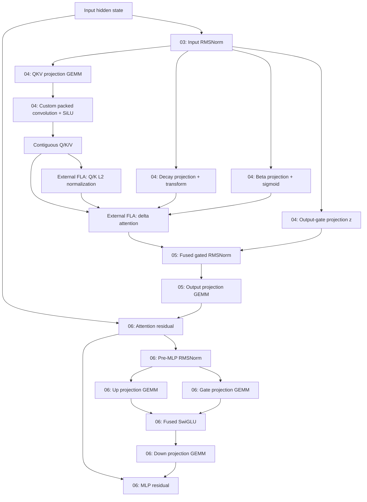

# Integrated compiled structure and subsequent fusion targets

Follow-up to [batch-one measurements and FLA layout investigation](batch-one-fla-layouts.md). This records the discussion after the packed-output integration, including the fresh source dump and proposed next experiments. No additional optimization described here has been implemented or benchmarked.

## Current result and immediate next steps

The integrated packed-output convolution improved the initial ten-measurement batch-one median graph-backed forward from 148.59 ms to 140.72 ms, about 5.3%. The tested decision probabilities were unchanged. This remains one request and forward-only timing, excluding tokenization/readout.

The next validation steps are broader requests at batch sizes one, two and four, probability comparisons, and end-to-end latency measurements. A fresh runtime trace should confirm removal of the three copies per delta layer and check unexpected allocations or graph breaks. A source dump helps inspect structure but does not replace runtime evidence.

Convolution with integrated Q/K normalization remains a candidate. Compare it against the packed-output producer plus existing FLA normalization, preserving intermediate BF16 rounding and keeping only measured improvements. Full-attention backend selection is another investigation, accounting for approximately 8.5% of the earlier batch-one listed GPU activity.

## Why optimize a delta block rather than rewrite the whole forward

Manual control is most valuable at producer/consumer boundaries: jointly choose layouts, remove intermediate allocations and traffic, and fuse operations where the complete sequence improves. Replacing already-fused pointwise kernels one-for-one is not automatically useful.

A delta-attention block is a contained experimental unit repeated eighteen times. It retains library GEMMs and FLA computation while exposing projection preparation, normalization/gating and residual boundaries to inspection. The convolution change established one measured benefit in that scope. Benchmark each complete block change before consolidating a manual block executor or expanding to a handwritten model runtime.

The earlier batch-one profile attributed approximately 68% of listed GPU activity to GEMMs and another 8.5% to full attention. Keeping those unchanged leaves less than a quarter for everything else, including retained FLA computation. This is a rough bound from old kernel-time shares, not a fresh critical-path analysis or a prediction of end-to-end gains.

No single GPU kernel covers the delta block. `Qwen3_5GatedDeltaNet.forward` orchestrates its attention operations; the supported path now uses `_forward` in `model/decider/packed_conv.py`. Input RMSNorm and residual addition belong to the enclosing decoder layer. The MLP is a separate sublayer after attention.

## Fresh post-integration source dump

Ran on Modal:

```bash
modal run src/dump_compiled_code.py --rows 1 --batch-size 1
```

Run: https://modal.com/apps/vijaygoyal0770/main/ap-i8MIRvgKD5WfxN8zJv3V6z

Generated eight complete Python files and downloaded them individually to `data/l4-source-b1-packed/`. All eight passed Python syntax compilation. Configuration was decider-2b-v11 on NVIDIA L4, token IDs `[1, 2048]`, PyTorch `2.14.1+cu130`.

| Source file | Characters |
| --- | ---: |
| `compiled_forward_01.py` | 23652 |
| `compiled_forward_02.py` | 30258 |
| `compiled_forward_03.py` | 10624 |
| `compiled_forward_04.py` | 16654 |
| `compiled_forward_05.py` | 12938 |
| `compiled_forward_06.py` | 23097 |
| `compiled_forward_07.py` | 118637 |
| `compiled_forward_08.py` | 7221 |

The custom Triton body remains in `model/decider/packed_conv_kernel.py`. Its opaque custom operation appears in the generated wrapper as `torch.ops.fastdecisions.packed_conv.default`; Inductor does not inline that implementation into the dump.

### Partition map

These files represent reusable compiled fragments, not eight sequential decoder layers or a count of runtime invocations.

| File | Role | Relevant code |
| --- | --- | --- |
| 01 | Causal/sequence mask preparation | [launches](../data/l4-source-b1-packed/compiled_forward_01.py#L292) |
| 02 | Rotary position preparation | [launches](../data/l4-source-b1-packed/compiled_forward_02.py#L347) |
| 03 | Input RMSNorm | [launch](../data/l4-source-b1-packed/compiled_forward_03.py#L156) |
| 04 | Delta QKV projection, packed convolution, decay/beta preparation and output-gate projection | [wrapper](../data/l4-source-b1-packed/compiled_forward_04.py#L171) |
| 05 | Fused delta output RMSNorm/gating and output projection | [wrapper](../data/l4-source-b1-packed/compiled_forward_05.py#L164) |
| 06 | Residual plus pre-MLP RMSNorm, MLP projections/SwiGLU and final residual | [wrapper](../data/l4-source-b1-packed/compiled_forward_06.py#L267) |
| 07 | Full softmax-attention layer path and its MLP | [wrapper](../data/l4-source-b1-packed/compiled_forward_07.py#L1238) |
| 08 | Restricted option-letter projection for all positions and FP32 conversion | [wrapper](../data/l4-source-b1-packed/compiled_forward_08.py#L101) |

Relative links point to local generated artifacts, which are ignored by Git. Line fragments document inspected locations; editor support for them may vary.

### Current delta flow

Arrows represent data dependencies, not concurrent execution. Skip connections are shown explicitly.



The attention residual and following RMSNorm are fused in partition 06. The final residual kernel can read the original hidden state and attention output to reconstruct the residual while adding the MLP output, rather than requiring every conceptual diagram node to correspond to a standalone materialized buffer.

External FLA still performs normalization, cumulative decay preparation, solve/w-u preparation, recurrent chunk-state computation (`h`) and output computation (`o`). Its internal kernels are not emitted by this Inductor source capture.

### What the custom-op boundary means

Partition 04 contains the QKV GEMM, custom packed-convolution call, and gate preparation in one compiled wrapper. The custom operation did not introduce a compilation break at that location. This does not fuse those operations into a single GPU launch: library GEMMs, the custom kernel and generated transforms still execute separately.

At lines 179-186, the wrapper checks Q/K/V output shape `[1, 2048, 16, 128]`, BF16 dtype and strides `[4194304, 2048, 128, 1]`. These match the fake implementation's promised contiguous layout. Runtime profiling is still the direct check that the former FLA contiguity copies disappear.

The fresh dump also confirms that output normalization and gating are already fused, and attention residual plus following RMSNorm are already fused. These are not obvious targets for separate one-for-one rewrites.

## Subsequent custom-kernel candidates

### Convolution plus Q/K normalization

The existing candidate removes copies but still materializes Q/K before FLA normalizes them. A fused producer could remove those intermediate writes/reads and normalization launches. It must cover all 128 features per head, reproduce BF16 rounding after SiLU before FP32 normalization, and disable FLA's duplicate normalization. V remains unnormalized. Reductions and register pressure can offset the saving; no gain is established yet.

### Narrow gate projections and transforms

Location: partition 04, in the branches feeding FLA alongside Q/K/V.

- Decay projection `a`: library GEMM at line 191.
- Decay transform: generated Triton at line 197, computing negative exponential of the learned decay parameter times softplus of the projected value plus bias.
- Beta projection `b`: library GEMM at line 203.
- Beta sigmoid: generated Triton at line 208.

Both projections read the same normalized hidden state and each produces 16 values per token. Combining them could reduce launches and repeated reads, but the total measured cost must justify it. Tiny activation durations alone do not establish useful savings.

The simplest experiment requires no custom matmul: concatenate the two projection weight matrices once, use a single library GEMM producing 32 values per token, then use one Triton kernel to produce decay and beta outputs. Preserve the projection BF16 rounding and output dtypes. This reduces the nominal sequence from two GEMMs plus two transforms to one GEMM plus one transform; it still materializes projection results.

A fully fused Triton kernel would implement both narrow matrix multiplications and their transforms before final stores. That is a separate, harder experiment.

### MLP projections plus SwiGLU

Location: partition 06, after attention residual and pre-MLP RMSNorm, before the down projection.

- Two library GEMMs at lines 272 and 277 produce gate/up activations.
- Generated Triton at line 283 applies SiLU and multiplication.
- Library GEMM at line 288 projects the intermediate down.

SwiGLU totaled approximately 6 ms in the earlier batch-one trace. A fused implementation might avoid storing both large projection intermediates, but requires efficient matmul as well as pointwise fusion. Preserve existing BF16 rounding boundaries when establishing correctness; removing them changes the computation.

An applicable library epilogue may offer another route, but ordinary activation support does not establish support for this exact two-projection SwiGLU operation. No compatible epilogue has been identified or validated in this work.

### Residual and normalization boundaries

Inspect remaining cross-layer boundaries for a materialized residual immediately reread by normalization. Several are already fused, so this is an investigation rather than an established opportunity. Choose layouts and buffer lifetimes across the complete sequence, not by optimizing isolated operations independently.

## What fusion with a library GEMM can and cannot mean

A normal Triton kernel cannot invoke a host-dispatched cuBLAS/CUTLASS library GEMM and then continue on its results within that same GPU kernel. Launching a library GEMM followed by Triton remains two launches with an intermediate tensor.

Eliminating that boundary requires implementing the multiplication within the fused kernel, or using a library implementation with the required epilogue. Existing Triton matmul templates can provide the multiplication structure; it is not necessary to design a matmul algorithm from scratch. However, adapting the projection pairing, precision behavior and tiling for L4 remains real engineering work.

There is no universal Triton matmul slowdown. A tuned implementation can compete for a specific shape; a basic implementation can lose substantially. The relevant criterion is

$$
T_{\mathrm{fused\ Triton}} < T_{\mathrm{library\ GEMM}} + T_{\mathrm{separate\ transforms}}.
$$

A fused matmul can tolerate some multiplication overhead only if eliminated traffic and launches compensate. Narrow 16-output gate projections are a more contained experiment than the large MLP projections, where a small GEMM slowdown could erase activation-fusion savings.

## Working order

1. Strengthen integrated correctness and latency comparisons over representative requests and low concurrency.
2. Audit a fresh runtime trace alongside the source dump.
3. Benchmark convolution with Q/K normalization fused against the current implementation.
4. Try concatenated gate weights with one library GEMM and one transform kernel, before taking responsibility for custom matmul performance.
5. Pursue MLP matmul/activation fusion only with evidence that the complete sequence improves.

All later fusion ideas remain proposals. The only integrated speedup established so far is the packed-output convolution result documented in the preceding note.
